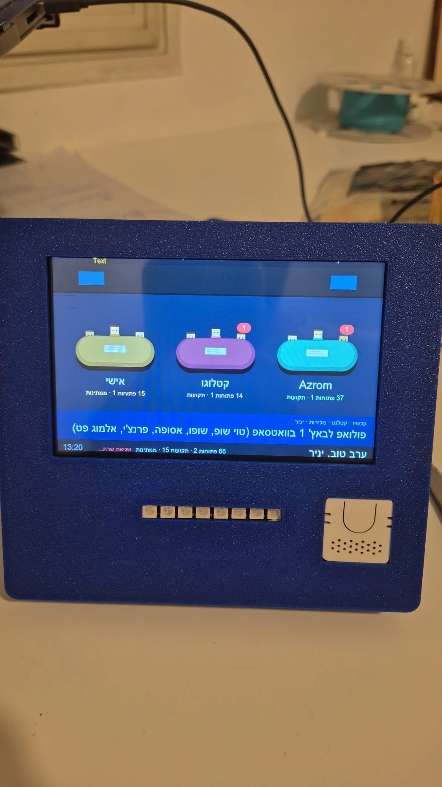
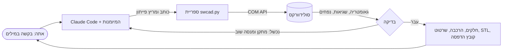

# קלוד × סולידוורקס

**קלוד עובד בשבילך בסולידוורקס: חלקים פרמטריים אמיתיים, הרכבות בדוקות וקבצים מוכנים להדפסה. הוא בונה ובודק הכל בעצמו.**

[English](README.md) · [מדריך למתחילים](docs/he/getting-started.md) · [איך זה עובד](docs/how-it-works.md) · [פרויקט לדוגמה](examples/desk-agent/README.md)

  

זו **מיומנות (skill) ל-[Claude Code](https://claude.com/claude-code)** שמחברת את קלוד לסולידוורקס שרץ אצלך במחשב.

**ככה זה עובד:**
1. אתה מתאר במילים מה אתה צריך.
2. קלוד כותב ומריץ קוד פייתון שמדבר עם סולידוורקס, ובונה את החלקים.
3. **הוא מודד את החלקים ובודק כל התאמה,** ורק אחר כך אומר לך שסיים.

אתה לא מעתיק שגיאות הלוך וחזור.

המארז שבתמונה תוכנן כך מהסקיצה הראשונה ועד קבצי ההדפסה. זה מכשיר שולחני עם מסך מגע, חיישן נוכחות, פס לדים ורמקול.

## מה זה יודע לעשות

- **חלקים פרמטריים:** כל מידה קשורה למשתנה עם שם, כך שאפשר להמשיך לערוך ביד דרך *Tools ← Equations*.
- **בדיקות לכל חלק:**
  - מידות חיצוניות ונפח, מול חישוב ידני.
  - בדיקת עריכה: משנים משתנה ובודקים שהחלק מגיב נכון.
  - שמירה, סגירה ופתיחה מחדש, בלי אף שגיאה.
- **הרכבות:** בדיקת התנגשויות מול רשימה של חפיפות מתוכננות, כמו לחיצה, צלעות מעיכה ותקע בשקע. חלקים זזים נבדקים בכל מצב.
- **הגנה על שינויים ידניים:** אם שינית חלק בעצמך, הסקריפטים מזהים את זה. הם מעדכנים במקום או עוצרים ושואלים, ולא דורסים לך עבודה.
- **בדיקות הנדסיות:** מאמץ בתפסנים, מומנט נעילה, יציבות נגד נפילה, שרשרת סבולות.
- **שרטוט ייצור:** גיליון A3 עם מידות שמחוברות לקצוות האמיתיים של המודל.
- **הדפסת תלת-ממד:**
  - כיוון הדפסה.
  - בדיקה אם צריך תמיכות.
  - פרויקט בבמבו סטודיו, חתוך ומוכן, עם זמן ומשקל לכל משטח.

## איך זה עובד, בתמונה אחת

הרעיון המרכזי: **לא סומכים על שום דבר שלא נמדד.** כל שלב נגמר במספרים: שגיאות, מספר גופים, מידות, נפח, נפחי התנגשות.

## התחלה מהירה

> מדריך מלא צעד אחרי צעד: **[docs/he/getting-started.md](docs/he/getting-started.md)**

1. **צריך:**
   - Windows.
   - סולידוורקס. נבדק על 2025, וגם גרסת הסטודנט עובדת.
   - [פייתון 3.10 ומעלה](https://www.python.org/downloads/).
   - [Claude Code](https://claude.com/claude-code).
2. מתקינים את הגשר לסולידוורקס: `python -m pip install pywin32 numpy`
3. מעתיקים את התיקייה [`skill/solidworks-api`](skill/solidworks-api) אל `%USERPROFILE%\.claude\skills\`.
4. פותחים את סולידוורקס בצורה רגילה ומריצים את הבדיקה העצמית `smoke_test.py`. בסוף צריך להופיע `SMOKE TEST OK`.
5. פותחים את Claude Code בתיקייה ריקה ומבקשים, למשל:
   > *תתכנן לי בסולידוורקס תושבת לקיר לצינור של 40 מ"מ, שני ברגי M5, להדפסה ב-PLA בלי תמיכות.*

## פרויקט לדוגמה

[`examples/desk-agent`](examples/desk-agent/README.md) הוא פרויקט אמיתי ומלא. יש בו:
- שלושה חלקי ניסיון.
- מארז עם תפסנים נסתרים.
- רגל מתכווננת עם נעילות.
- בדיקות הרכבה ב-6 זוויות.
- חישוב יציבות.
- שרטוט ייצור.

וגם רשימה כנה של מה שהשתבש, ומה המיומנות למדה מזה.

## רישיון

[MIT](LICENSE). SolidWorks הוא סימן מסחרי של Dassault Systèmes. אין לפרויקט קשר ל-Dassault Systèmes או ל-Anthropic.

