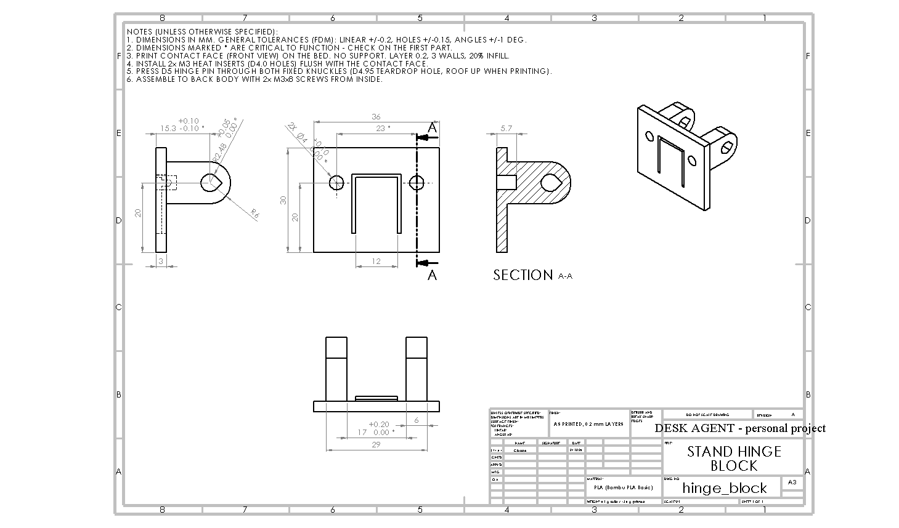
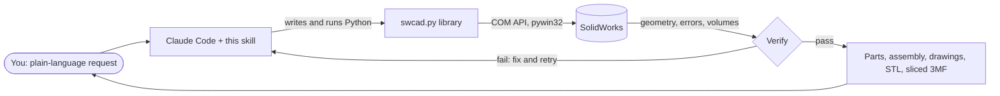

# Claude × SolidWorks

**Let Claude drive SolidWorks for you: real parametric parts, checked assemblies and print-ready files, built and verified by the AI itself.**

[עברית](README.he.md) · [Getting started](docs/getting-started.md) · [How it works](docs/how-it-works.md) · [Workflow](docs/workflow.md) · [Troubleshooting](docs/troubleshooting.md) · [Example project](examples/desk-agent/README.md)

<p align="center">
  
</p>

This repository is a **skill for [Claude Code](https://claude.com/claude-code)** that connects Claude to a SolidWorks running on your Windows PC. You describe what you need, in plain words. Claude writes and runs Python that talks to SolidWorks over its COM API, builds the parts, **measures them, checks every fit, and only then tells you it's done.** You never copy error messages back and forth.

The enclosure in the photo above (a desk display with a touch screen, a presence radar, a light bar and a speaker) was designed this way from the first sketch to the sliced print files.

## What it can do

| | |
|---|---|
| **Parametric parts** | Every dimension is linked to a named global variable, so you can still edit the part by hand in *Tools → Equations*. |
| **Verification** | Bounding box and volume checked against hand calculations, an edit test, save-close-reopen with zero rebuild errors. |
| **Assemblies** | Interference checks with an explicit list of *designed* overlaps (press fits, crush ribs, plug in socket); moving parts swept through every position. |
| **Hand-edit protection** | Change a part yourself and the scripts notice. They update in place or stop and ask, and they never silently overwrite your work. |
| **Engineering checks** | Snap-fit strain, detent holding torque, tipping stability, tolerance stacks. |
| **Production drawings** | ISO A3 sheets with dimensions attached to model edges, tolerances and a filled title block. |
| **3D printing** | Print orientation, overhang and support analysis, and sliced Bambu Studio projects with time and filament per plate. |

<p align="center">
  
  
  
</p>

## How it works, in one picture



The key idea is **not trusting anything that hasn't been measured**. Every step ends with numbers: errors, body count, bounding box, volume, interference volumes. A step that can't show its numbers isn't done. [More in *How it works* →](docs/how-it-works.md)

## Quick start

> Complete step-by-step guide for beginners: **[docs/getting-started.md](docs/getting-started.md)**

1. **You need:** Windows, SolidWorks (tested on 2025, Student Edition works), [Python 3.10+](https://www.python.org/downloads/) and [Claude Code](https://claude.com/claude-code).
2. Install the Python bridge:
   ```bash
   python -m pip install pywin32 numpy
   ```
3. Install the skill: copy [`skill/solidworks-api`](skill/solidworks-api) to `%USERPROFILE%\.claude\skills\`. Or, in the Claude desktop app, upload [`dist/solidworks-api.skill`](dist/solidworks-api.skill).
4. Open SolidWorks normally (not *Run as administrator*) and run the self test:
   ```bash
   python "%USERPROFILE%\.claude\skills\solidworks-api\scripts\smoke_test.py"
   ```
   It should print `SMOKE TEST OK`.
5. Open Claude Code in an empty project folder and ask, for example:
   > *Design a wall bracket in SolidWorks for a 40 mm pipe, two M5 screws, printable in PLA without supports.*

## Why a skill and not a plugin or macro?

SolidWorks' API is huge and full of traps: out-parameters, untyped objects, selection marks, cut directions, equations that report errors until you reopen the file. The skill packages **47 traps that each broke a real build, each with its fix**, a small library that handles them, and a method: ask for the missing measurements first, print test coupons before the big part, verify everything. [The full list →](skill/solidworks-api/references/pitfalls.md)

## Example: the desk agent

A full real project in [`examples/desk-agent`](examples/desk-agent/README.md): component reference models, three printed test coupons, a front frame with hidden snap fits, a back body, a light diffuser, an adjustable kickstand with detents, assembly checks at six stand angles, stability analysis, a production drawing and sliced print files. It includes the honest list of what went wrong and what the skill learned from it.

## Repository layout

```
skill/solidworks-api/      the skill itself (SKILL.md, scripts, references)
dist/solidworks-api.skill  the same, packed for upload
docs/                      beginner guide, architecture, workflow, troubleshooting (docs/he: Hebrew)
examples/desk-agent/       a complete project built with the skill
assets/images/             pictures used in the docs
```

## License

[MIT](LICENSE). SolidWorks is a trademark of Dassault Systèmes. This project is not affiliated with Dassault Systèmes or Anthropic.
