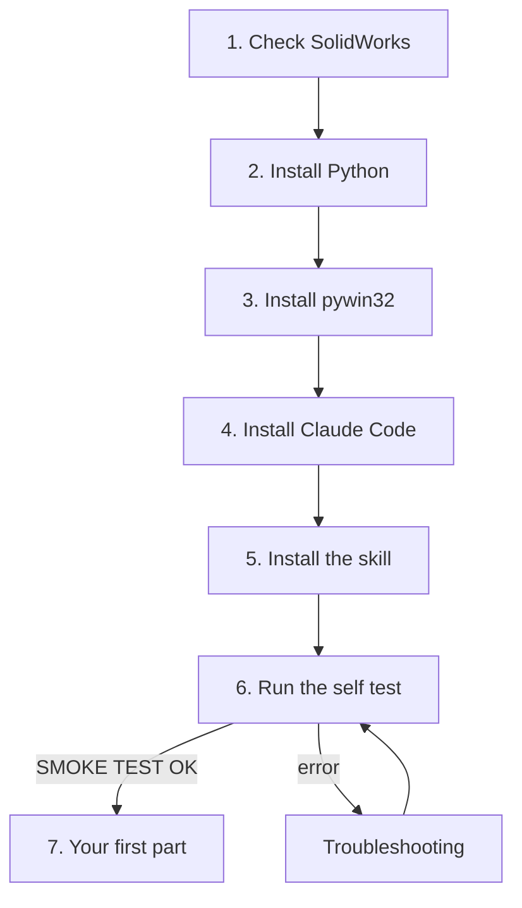
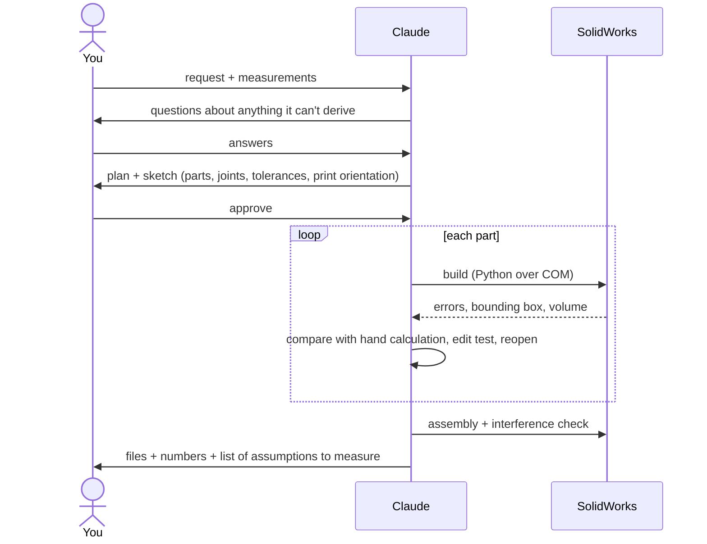

# Getting started: from zero to your first part

This guide assumes nothing. If you have never used Python or a terminal, follow it top to bottom; it takes about 20 minutes.



## 1. Check SolidWorks

- Any recent SolidWorks on Windows. It was tested on **SolidWorks 2025**, including the Student Edition.
- Start it **the normal way** from the Start menu. Don't use *Run as administrator*: an elevated SolidWorks is invisible to other programs, and the scripts can't reach it.
- Several installs side by side (`SOLIDWORKS`, `SOLIDWORKS (2)`...) are fine. The scripts use the one that is running.

## 2. Install Python

1. Download Python 3.12 from [python.org/downloads](https://www.python.org/downloads/).
2. In the installer, **tick "Add python.exe to PATH"** before clicking *Install*.
3. Check it: open *Command Prompt* (Start → type `cmd`) and run
   ```bash
   python --version
   ```
   You should see `Python 3.12.x`.

## 3. Install the bridge to SolidWorks

In the same Command Prompt:

```bash
python -m pip install pywin32 numpy
```

`pywin32` lets Python talk to Windows programs (COM). `numpy` is optional and is used for area and volume checks of curved shapes.

## 4. Install Claude Code

Follow the official instructions at [claude.com/claude-code](https://claude.com/claude-code). Any form works: the desktop app (Code tab), the terminal CLI, or the VS Code extension. Sign in with your Claude account.

## 5. Install the skill

**Option A: copy the folder (Claude Code).**
Copy the folder [`skill/solidworks-api`](../skill/solidworks-api) from this repository to:

```
C:\Users\<your name>\.claude\skills\solidworks-api
```

If you use git:

```bash
git clone https://github.com/<owner>/claude-solidworks
xcopy /E /I claude-solidworks\skill\solidworks-api "%USERPROFILE%\.claude\skills\solidworks-api"
```

**Option B: upload the packed file (Claude desktop app).**
Open the skills section of the app's settings and upload [`dist/solidworks-api.skill`](../dist/solidworks-api.skill). The menu names change between versions, so search the settings for "Skills".

Claude loads the skill by itself whenever you ask for SolidWorks work. You don't need a special command.

## 6. Run the self test

With SolidWorks open:

```bash
python "%USERPROFILE%\.claude\skills\solidworks-api\scripts\smoke_test.py"
```

In about a minute it builds a small part, changes a dimension, reopens the file, exports an STL and checks all of it. The last line must be:

```
SMOKE TEST OK
```

Anything else: see [Troubleshooting](troubleshooting.md). Run this test again whenever SolidWorks was restarted or updated. It catches session problems in one minute instead of in the middle of a long build.

## 7. Your first part

1. Make an empty folder for the project, for example `Documents\bracket`.
2. Open Claude Code in that folder.
3. Ask in plain words, with the measurements you know:

   > *Design a wall bracket in SolidWorks for a 40 mm pipe. Two M5 countersunk screws 60 mm apart. 3D printed in PLA on a Bambu A1, no supports.*

What happens next:



The parts are saved in `parts\` inside your project folder, as normal `.sldprt` files. Open them in SolidWorks like any other part.

## Good habits that save time and credits

- **Give measurements up front**, and say which ones you measured and which you're guessing.
- **For boards and modules, send a photo from the side you'll look at.** Directions described from the back mirror the whole design.
- **List every cable and connector you'll actually plug in.** Each one gets space reserved in the model.
- **Print the test coupons** the skill suggests (snap, hinge, press fit) before the big part. Twenty minutes of printing saves hours.
- **Small changes:** ask Claude to *update* the part, not to rebuild it. Value-only changes take seconds. See [Workflow → Changing a part](workflow.md#changing-a-part).
- **Editing by hand is fine.** The scripts detect your edits and ask before touching the part. See [How it works → Hand edits](how-it-works.md#hand-edits).

Next: [How it works](how-it-works.md) · [Workflow](workflow.md)
