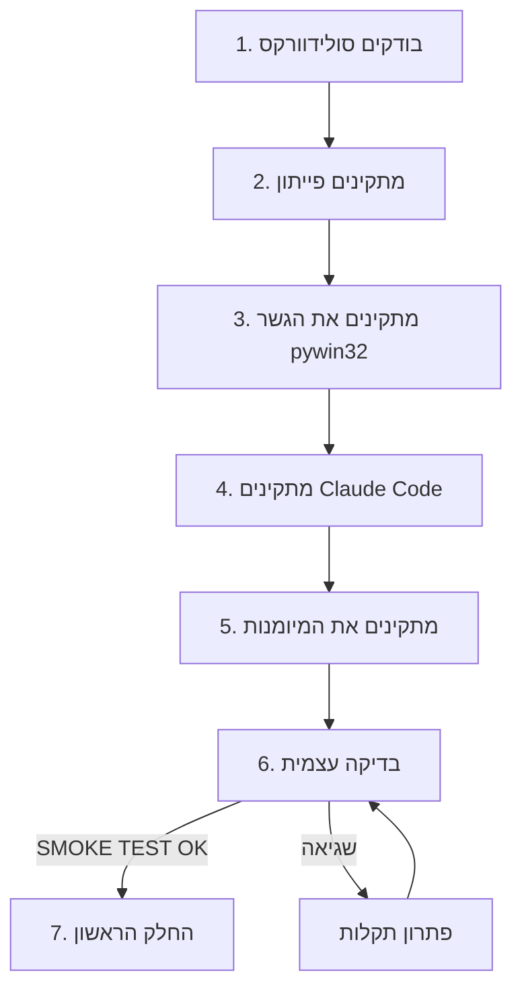

<div dir="rtl">

# מדריך למתחילים: מאפס לחלק הראשון

המדריך לא מניח שום ידע קודם. גם אם מעולם לא השתמשת בפייתון או בחלון פקודות, פשוט עובדים לפי הסדר. זה לוקח בערך 20 דקות.

</div>



<div dir="rtl">

## 1. סולידוורקס

- כל גרסה עדכנית ל-Windows. נבדק על **2025**, כולל גרסת הסטודנט.
- **פותחים בצורה רגילה** מתפריט ההתחלה, ולא "הפעל כמנהל". סולידוורקס שרץ כמנהל לא נראה לתוכנות אחרות, והסקריפטים לא יגיעו אליו.
- אם מותקנות כמה גרסאות, זה בסדר. הסקריפטים משתמשים בזו שפתוחה.

## 2. פייתון

1. מורידים פייתון 3.12 מ-[python.org/downloads](https://www.python.org/downloads/).
2. בהתקנה **מסמנים "Add python.exe to PATH"** לפני שלוחצים Install.
3. בודקים: פותחים "שורת הפקודה" (מתחילים ← מקלידים `cmd`) ומריצים `python --version`. צריך להופיע `Python 3.12`.

## 3. הגשר לסולידוורקס

באותו חלון:

</div>

```bash
python -m pip install pywin32 numpy
```

<div dir="rtl">

- `pywin32` מאפשר לפייתון לדבר עם תוכנות Windows.
- `numpy` לא חובה. משתמשים בו לבדיקות של שטחים ונפחים בצורות מעוגלות.

## 4. Claude Code

מתקינים לפי ההוראות ב-[claude.com/claude-code](https://claude.com/claude-code): האפליקציה (לשונית Code), הטרמינל, או התוסף ל-VS Code. כל אחת מהן עובדת. מתחברים עם חשבון Claude.

## 5. המיומנות

**דרך א':** מעתיקים את התיקייה `skill/solidworks-api` מהמאגר אל:

</div>

```
C:\Users\<השם שלך>\.claude\skills\solidworks-api
```

<div dir="rtl">

**דרך ב' (אפליקציית Claude):** מעלים את הקובץ `dist/solidworks-api.skill` באזור המיומנויות שבהגדרות. השמות בתפריט משתנים בין גרסאות, אז כדאי לחפש בהגדרות "Skills".

קלוד טוען את המיומנות לבד בכל פעם שמבקשים עבודה בסולידוורקס. לא צריך פקודה מיוחדת.

## 6. בדיקה עצמית

כשסולידוורקס פתוח:

</div>

```bash
python "%USERPROFILE%\.claude\skills\solidworks-api\scripts\smoke_test.py"
```

<div dir="rtl">

הבדיקה לוקחת כדקה:
- בונה חלק קטן.
- משנה בו מידה.
- פותחת אותו מחדש.
- מייצאת STL ובודקת את הכל.

בסוף צריכה להופיע השורה `SMOKE TEST OK`. אם מופיע משהו אחר, עוברים ל[פתרון תקלות](../troubleshooting.md).

**כדאי להריץ את הבדיקה שוב בכל פעם שסולידוורקס נפתח מחדש או מתעדכן.** היא תופסת בעיות תוך דקה, במקום באמצע בנייה ארוכה.

## 7. החלק הראשון

1. יוצרים תיקייה ריקה לפרויקט, למשל `Documents\bracket`.
2. פותחים בה את Claude Code.
3. מבקשים במילים פשוטות, עם המידות שידועות לך:
   > *תתכנן תושבת לקיר לצינור 40 מ"מ, שני ברגי M5 שקועים במרחק 60 מ"מ, להדפסה ב-PLA על Bambu A1 בלי תמיכות.*

**מה קורה אחר כך:**
1. קלוד שואל על כל מה שהוא לא יכול לחשב לבד.
2. הוא מציג תוכנית עם סקיצה, ומחכה לאישור שלך.
3. הוא בונה כל חלק ובודק אותו.
4. הוא בודק את ההרכבה.
5. הוא מוסר לך את הקבצים, את המספרים, ואת רשימת ההנחות שעוד צריך למדוד.

החלקים נשמרים בתיקייה `parts` בתוך הפרויקט, כקבצי `.sldprt` רגילים.

## הרגלים שחוסכים זמן וקרדיטים

- **נותנים מידות מההתחלה,** ואומרים מה מדדת ומה הערכה.
- **לוחות ומודולים: שולחים תמונה מהצד שממנו מסתכלים עליהם.** כיוונים שמתוארים מהגב הופכים את כל התכנון.
- **מפרטים כל כבל ומחבר שבאמת יתחברו.** לכל אחד נשמר מקום במודל.
- **מדפיסים את חלקי הניסיון** שהמיומנות מציעה לפני החלק הגדול. עשרים דקות הדפסה חוסכות שעות.
- **שינוי קטן:** מבקשים "לעדכן את החלק, לא לבנות מחדש". שינוי של ערך לוקח שניות.
- **מותר לערוך ביד.** הסקריפטים מזהים את השינויים ושואלים לפני שהם נוגעים בחלק.

</div>
