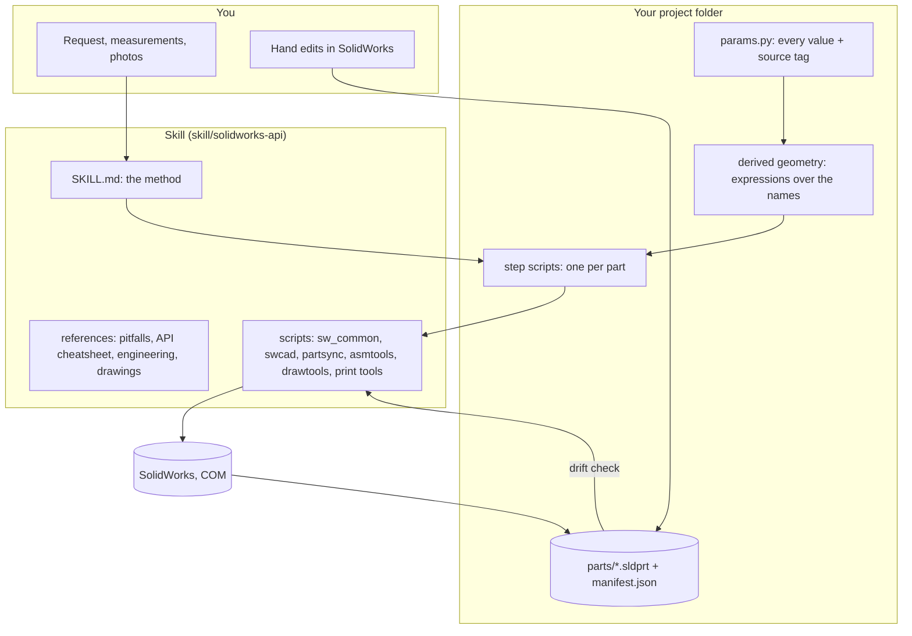
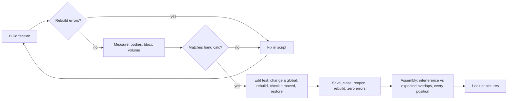
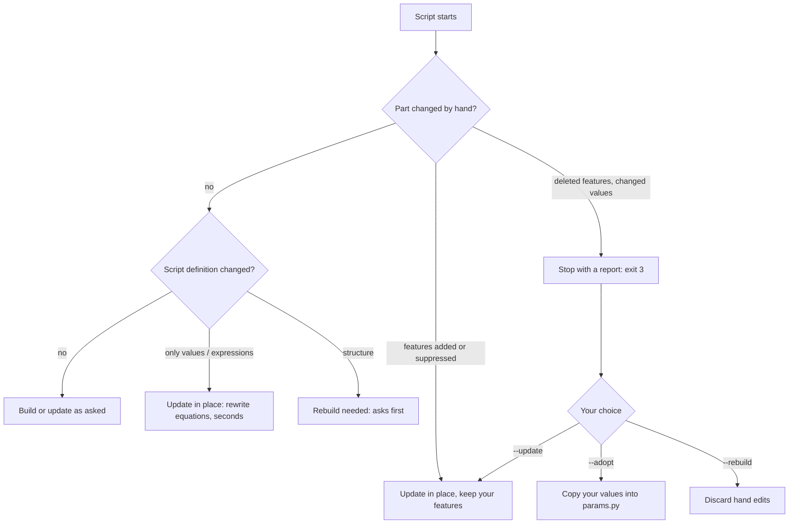

# How it works

## The pieces



| Piece | Job |
|---|---|
| `SKILL.md` | The method Claude follows: engineering before modeling, plan and approval, build, verify, print. |
| `sw_common.py` | Connects to the running SolidWorks, loads its type libraries (early binding), wraps every object in its interface, and creates, saves and closes only the documents it made. |
| `swcad.py` | `PartBuilder`: planes, sketches (rectangles, rounded rectangles, circles, polylines), extrudes and cuts. **Every dimension is linked to an equation** over named global variables. Includes checks, the edit test and the verified save. |
| `partsync.py` | Hand-edit protection: manifests, drift reports, the build or update decision. |
| `asmtools.py` | Places parts by transform, runs interference with expected overlaps, takes pictures, exports STL. |
| `drawtools.py` | Production drawings: dimensions attached to real model edges, then verified. |
| `overhangs.py`, `orient_stl.py`, `bambu_project.py` | The print pipeline. |
| `references/pitfalls.md` | 47 API traps, each one with symptom, cause and fix. |

## One parameter file, one source of truth

Every number lives in `params.py` with a **source tag**:

```python
PCB_W=137.0,        # [M] measured
GLASS_W=120.7,      # [D] datasheet
SNAP_L=12.0,        # snap tongue length (strain = 1.5*t*y/L^2 = 1.2 %)
INSERT_D=4.0,       # [A] assumption - check the insert you have
```

`[M]` measured, `[D]` datasheet, `[C]` calculated, `[A]` assumption. Every `[A]` value is listed back to you before printing. Derived geometry is written once as expressions (`CAV_W = "(2*(PCB_W/2 + PCB_CLR))"`) so that all parts agree.

## The verification loop



Why every step:

- **Rebuild errors:** an API call can "succeed" and leave a broken feature behind.
- **Hand calculation:** the geometry can look right on screen and still be wrong.
- **Edit test:** a sketch without proper relations has the right shape at build time, then deforms when you edit a dimension.
- **Reopen:** some errors exist only in the session that created them, and some appear only after reopening.
- **Expected overlaps:** a press fit or a plug in its socket *should* overlap. An overlap that isn't on the list is a bug, and so is a missing one.
- **Pictures:** once, every number passed while the stand leg was attached to its wheel by a 1 mm sliver. Only the side view showed it.

## Hand edits

You can always open a part and change it yourself. Every save writes `<part>.sldprt.manifest.json`: the script's feature definitions plus the state of the saved file. Before touching a part again, the script compares:



## Talking to SolidWorks, in short

- **Early binding:** SolidWorks doesn't publish type information to Python's usual tools, so the scripts load the `.tlb` files from the install folder themselves. Without this, methods behave like properties and nothing works.
- **Everything returned is untyped**, so every object is wrapped: `T(obj, "IModelDoc2")`.
- **Units:** the API always works in meters, and the parts are set to MMGS.
- **Sketching:** snapping and inference are switched off while the script draws, so a point 0.25 mm from the origin doesn't snap to it. Your settings are restored on exit, even after a crash.
- **Speed:** equations are added without solving, then solved once at the end. Solving after each one made builds take minutes.

The full list: [pitfalls.md](../skill/solidworks-api/references/pitfalls.md) · call signatures that are known to work: [api_cheatsheet.md](../skill/solidworks-api/references/api_cheatsheet.md)
