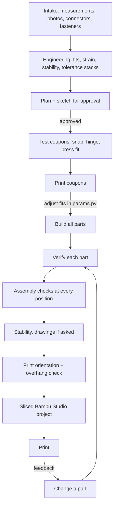
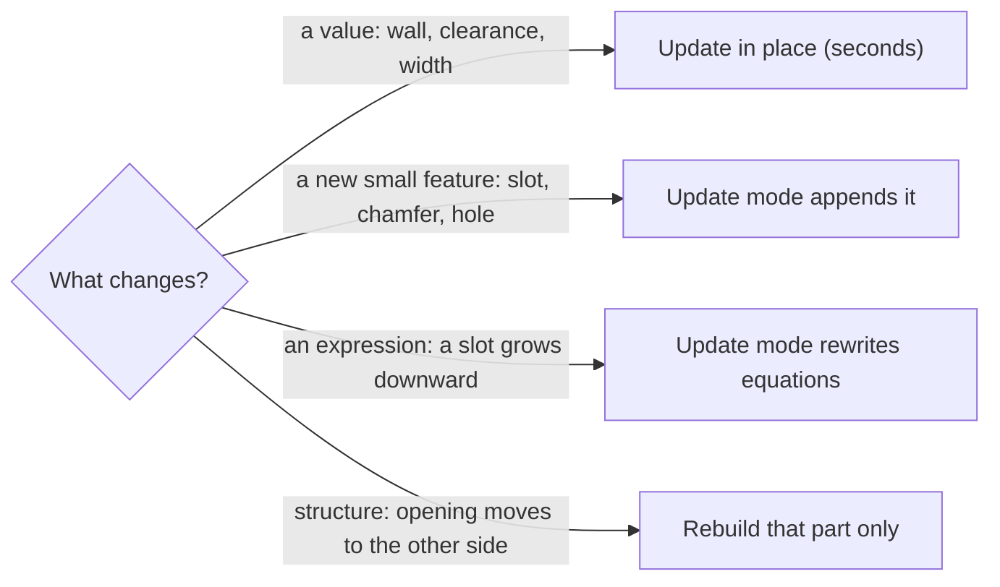

# Workflow: from idea to printed part

## 1. Intake: the questions that prevent reprints

Each of these cost a reprint at least once in the example project:

| Ask for | Why |
|---|---|
| **A labelled photo of each board from the side you'll look at** | Directions given from the back of a board mirror the whole design. |
| **Every connector you'll use, with its plug and cable** | Plugs and wires need room. If they aren't in the model, the checks can't see them. |
| **What holds each loose component in all six directions** | A module sitting in a window can slide out unless something stops it. |
| **Fasteners and inserts you actually have** | Screw length against insert depth. |
| **Printer and material** | Clearances change with the printer: about 0.2 mm on a Bambu A1 with PLA. |

## 2. Engineering before modeling

The formulas are in [engineering.md](../skill/solidworks-api/references/engineering.md):

- **Snap-fit strain** ε = 1.5·t·y/L². For PLA keep it ≤ 1 % if it opens often, ~2 % if it's one-off.
- **Detent holding torque** against the weight it has to carry.
- **Stand angle and tipping:** where the centre of mass is relative to the contact points, at every stand position.
- **Tolerance stack along each joint.** Preloads push parts apart: crush ribs, detents. A snap hook's axial play must be larger than those preloads, or the hook never reaches its groove.

## 3. Test coupons

Small prints that test one fit each, in about 20 minutes: a snap tongue in a groove, a hinge with its pin and detent, a board in its frame with the USB opening. You print them, report what was tight or loose, and the fit values in `params.py` change before the real parts are built.

## 4. Build and verify

One script per part (`step2_front_frame.py` ...), plus `build_all.py` that runs them in order. Every part goes through the [verification loop](how-it-works.md#the-verification-loop).

## 5. Print

1. `export_stl`, then `orient_stl.py --rot flip_x|side_x|side_y|keep`, so each part rests flat on Z=0.
2. `overhangs.py`: flat downward faces are bridges, fine when short. Sloped faces need support, so re-orient or redesign instead (constant profiles print on their side).
3. `bambu_project.py`: arranges the parts, slices them with your own Bambu Studio presets, and reports minutes, grams, whether supports were used, and warnings.

## Changing a part

Pick the cheapest path that does the job:

- **A value** (wall, clearance, width): *update in place*, which takes seconds. Or change it yourself in *Tools → Equations → Global Variables*.
- **A new small feature** (slot, chamfer, hole): *update mode* appends it at the end of the feature tree.
- **An expression** (for example a slot that should grow downward): *update mode* rewrites the equations in place.
- **Structure** (an opening moves to the other side): *rebuild* that part only. It's safe when there are no hand edits, and the script checks for them first.

Ask Claude for the cheapest path explicitly ("update the part, don't rebuild"). It's faster and uses fewer credits.
