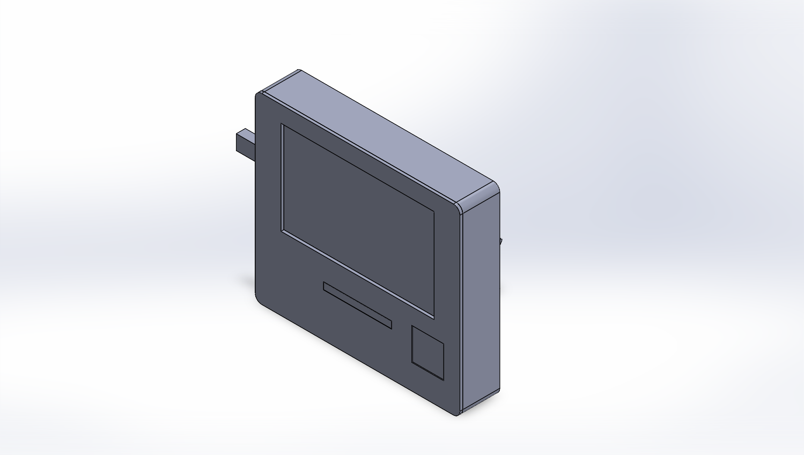
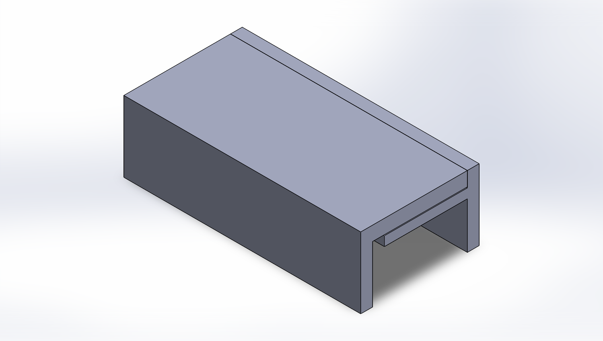
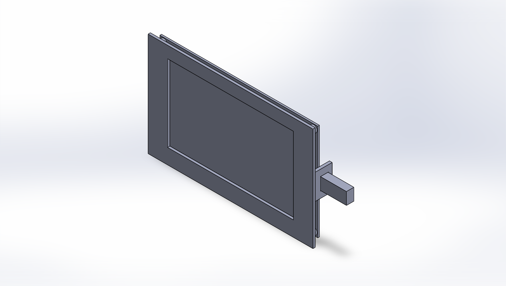
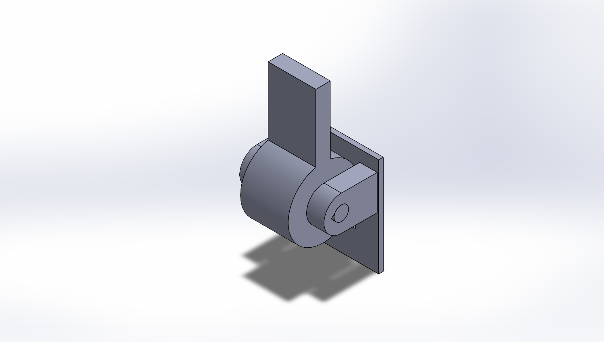

# Example: the desk agent

A desk display for the office: a Sunton ESP32-8048S050 5" touch screen, an M5Stack Atom Echo speaker, an HLK-LD2410C presence radar and an 8-LED light bar, in a 3D-printed enclosure with hidden snap fits and an adjustable kickstand. Designed with this skill from the first measurement to sliced print files.

<p align="center">
  
  
</p>

## Parts

| Part | Script | Notes |
|---|---|---|
| Component references | `step0_components.py` | Keep-out bodies for the screen, radar, Atom, LED bar, USB plug and the plugs in the board's edge connectors. |
| Test coupons A, B, C | `step1_coupons.py` | Snap tongue; board in frame with USB opening; hinge with detent and press-fit pin. |
| Front frame | `step2_front_frame.py` | Screen window, diffuser slot, Atom window with a front stop rim, radar behind a 1.5 mm wall, lip with 4 snap hooks. |
| Back body | `step3_back_body.py` | Snap grooves, PCB clamp posts with crush ribs, USB openings, vents. |
| Diffuser | `step4_diffuser.py` | White PLA light bar, held by a flange. |
| Stand | `step5_stand.py` | Hinge block (2× M3 into heat inserts, from inside), leg with 6 detent positions, press-fit pin. |
| Assembly | `step6_assembly.py` | Interference at all 6 stand angles, with the designed overlaps listed. |
| Stability | `step7_stability.py` | Centre of mass vs. contact points at 15° to 35° of tilt. |
| Drawing | `step8_drawing.py` | ISO A3 production drawing of the hinge block. |
| Print | `make_print_stls.py`, `bambu_final.py` | Orientation, overhang check, two sliced plates plus the diffuser in white. |

All values are in [`scripts/params.py`](scripts/params.py), each with its source tag. `build_all.py` rebuilds everything in order.

<p align="center">
  
  
  
</p>

## What went wrong, and what the skill learned

The honest list. Each item is now a rule in the skill.

| What happened | Root cause | Rule now |
|---|---|---|
| The charging opening was on the wrong side, so the back was reprinted | The board's directions were given looking at its back | Ask for a labelled photo from the viewing side |
| No room for the cables in the edge connectors | The connectors were mentioned but never modeled, so no check could catch it | Every interface becomes a keep-out body from day one |
| The Atom could slide out of its window | Interference checks don't tell you what *holds* a part | Check retention in all six directions |
| The snap hook didn't reach its groove | Crush ribs push the frame out 0.2 mm, while the hook play was 0.1 mm | Tolerance-stack every joint |
| The stand tilt was wrong in the first design | A formula error, caught by the stability check | Never report a result without its own numeric check |
| Two-hour stall on a SolidWorks hang | Retried the same hanging call instead of switching strategy | Stop after two failures; smoke-test new sessions; trace long builds |

## Using these scripts

They are an example, written for these components and the author's measurements. To reuse them, copy the folder, edit `params.py` with your own values, and run the scripts in order with SolidWorks open:

```bash
python build_all.py
```
